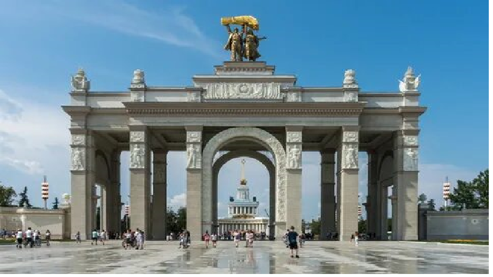

# ВДНХ

[Moscowsights](README.md)
[Моско́вский Кремль](Моско́вскийКремль.md)
[ВДНХ](ВДНХ.md)
[Третьяко́вка](Третьяко́вка.md)
[Оста́нкинская телеба́шня](Оста́нкинскаятелеба́шня.md)
[Моско́вский зоопа́рк ](Моско́вскийзоопа́рк.md)

Вы́ставка достиже́ний наро́дного хозя́йства (ВДНХ) (в 1939—1959 годах — Всесою́зная сельскохозя́йственная вы́ставка (ВСХВ), в 1959—1992 годах — Вы́ставка достиже́ний наро́дного хозя́йства СССР (ВДНХ СССР), в 1992—2014 годах — Всеросси́йский вы́ставочный центр (ВВЦ)) — выставочный комплекс в Останкинском районе Северо-Восточного административного округа города Москвы, крупнейший выставочный комплекс в городе. Входит в 50 крупнейших выставочных центров мира. Ежегодно ВДНХ посещают 30 млн гостей. 1 августа 2019 года выставка отпраздновала 80-летний юбилей.
просп. Мира, 119В, Москва (Выставка достижений народного хозяйства)
Метро: Выставочный центр, ВДНХ, Улица Сергея Эйзенштейна

Moscowsights 2026

<!--LiveInternet counter--><!--/LiveInternet-->
<!-- Top.Mail.Ru counter -->

<noscript>

</noscript>
<!-- /Top.Mail.Ru counter -->
<!-- Top100 (Kraken) Counter -->

<noscript>
  
</noscript>
<!-- END Top100 (Kraken) Counter -->
