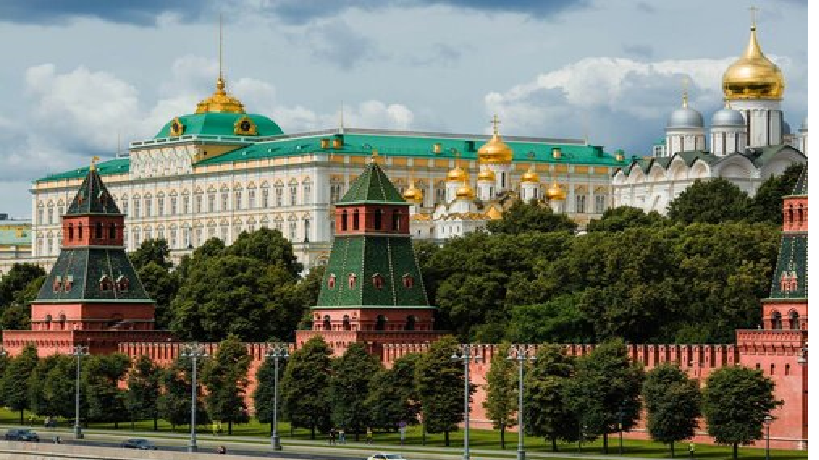

# Моско́вский Кремль

[Moscowsights](README.md)
[Моско́вский Кремль](Моско́вскийКремль.md)
[ВДНХ](ВДНХ.md)
[Третьяко́вка](Третьяко́вка.md)
[Оста́нкинская телеба́шня](Оста́нкинскаятелеба́шня.md)
[Моско́вский зоопа́рк ](Моско́вскийзоопа́рк.md)

Моско́вский Кремль — крепость в центре Москвы и древнейшая её часть, главный общественно-политический и историко-художественный комплекс города, официальная резиденция Президента Российской Федерации, вплоть до распада СССР в декабре 1991 года была официальной резиденцией Генерального секретаря ЦК КПСС (в 1990—1991 годах — Президента СССР). Одно из самых известных архитектурных сооружений в мире.

Ивановская площадь, Москва
Метро: Александровский сад, Библиотека им. Ленина, Арбатская

Moscowsights 2026

<!--LiveInternet counter--><!--/LiveInternet-->
