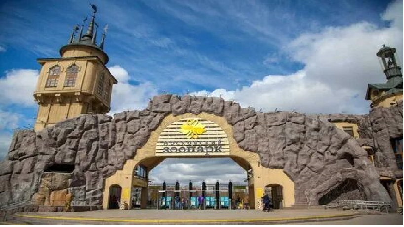

# Моско́вский зоопа́рк 
Моско́вский зоопа́рк (Государственное автономное учреждение культуры «Московский государственный зоологический парк») — зоологический парк в центре Москвы.
Один из старейших зоопарков (1864) в Европе и пятый по площади зоопарк России после зоопарков Ярославля, Ростова-на-Дону, Новосибирска и Красноярска. Входит в десятку самых посещаемых зоопарков мира (до 3,8 млн человек в год).

          Большая Грузинская ул., 1, стр. 1, Москва
Баррикадная, Краснопресненская, Улица 1905 года

ул. Академика Королёва, 15, корп. 1, Москва
Метро: Телецентр, Улица Академика Королёва, Бутырская

Moscowsights 2026
