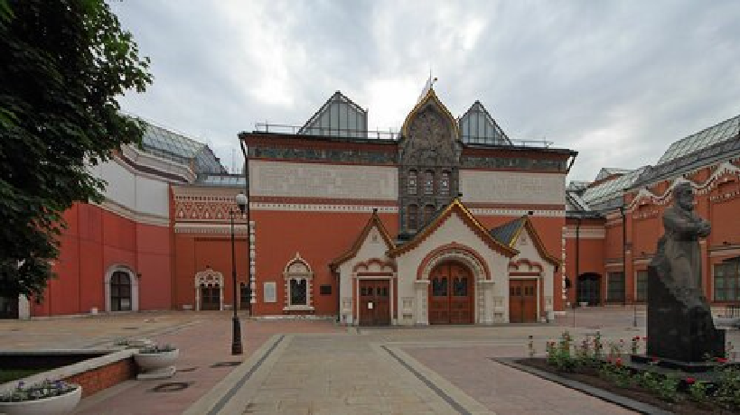

# Третьяко́вка

[Moscowsights](README.md)
[Моско́вский Кремль](Моско́вскийКремль.md)
[ВДНХ](ВДНХ.md)
[Третьяко́вка](Третьяко́вка.md)
[Оста́нкинская телеба́шня](Оста́нкинскаятелеба́шня.md)
[Моско́вский зоопа́рк ](Моско́вскийзоопа́рк.md)

Третьяко́вская галере́я, Госуда́рственная Третьяко́вская галере́я (сокр. ГТГ; разг. Третьяко́вка) — российский государственный художественный музей в Москве, созданный на основе исторических коллекций купцов братьев Павла и Сергея Михайловичей Третьяковых; одно из крупнейших в мире собраний русского изобразительного искусства.

Лаврушинский пер., 10, стр. 4, Москва
Метро: Третьяковская, Новокузнецкая

Moscowsights 2026

<!--LiveInternet counter--><!--/LiveInternet-->
